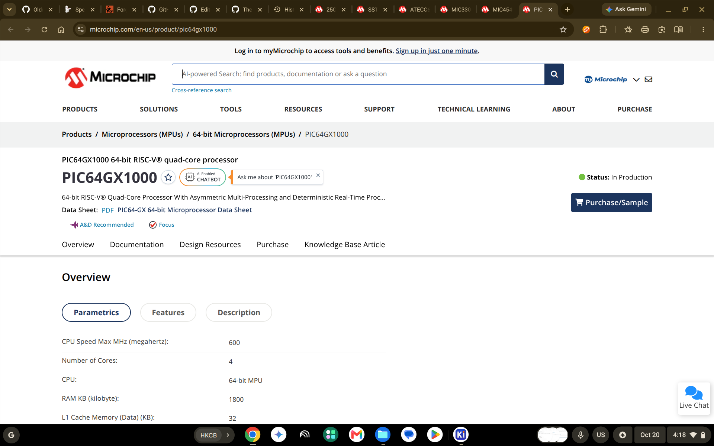
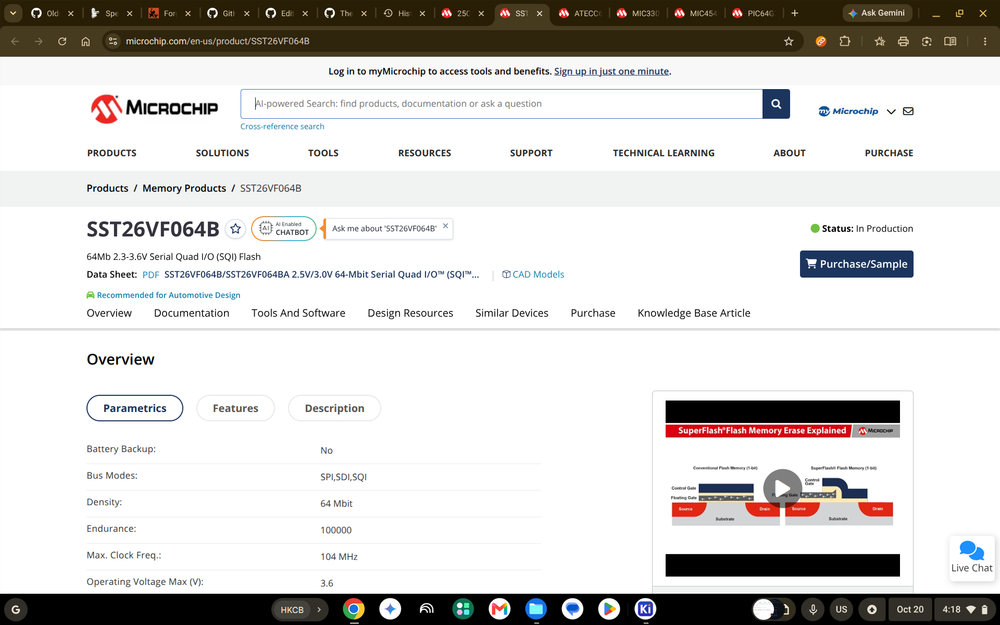
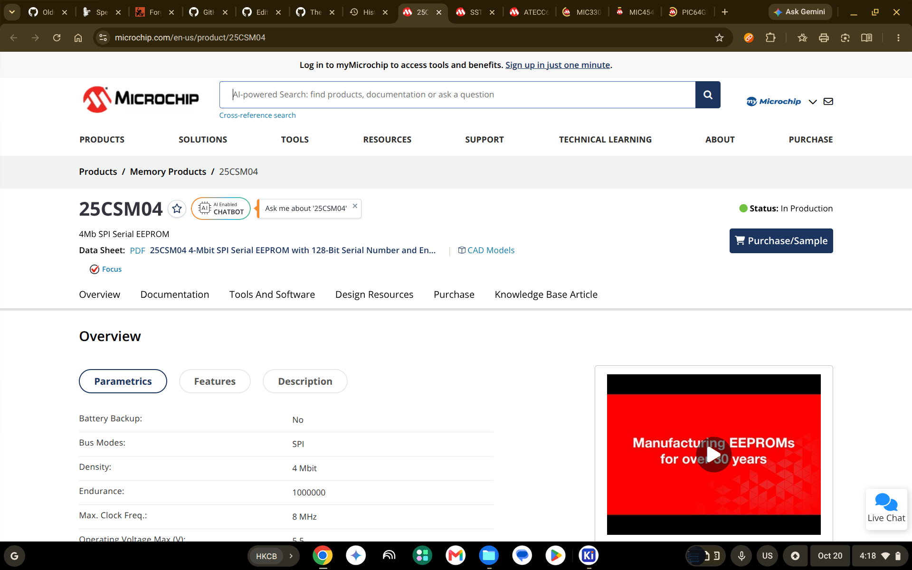
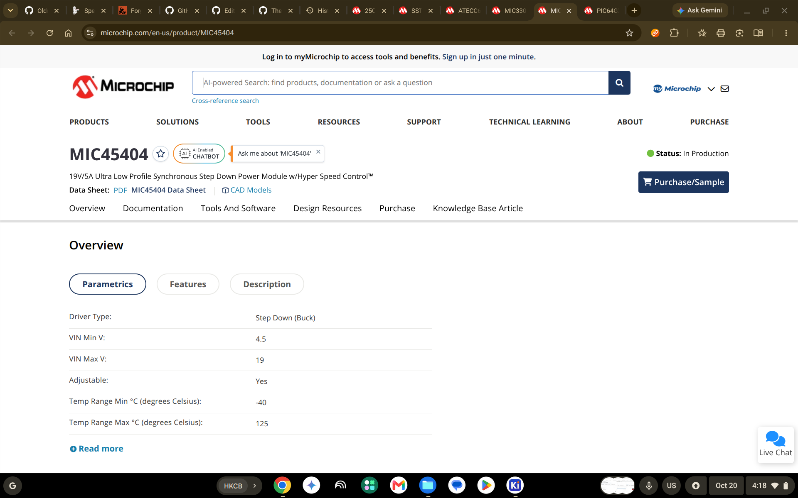
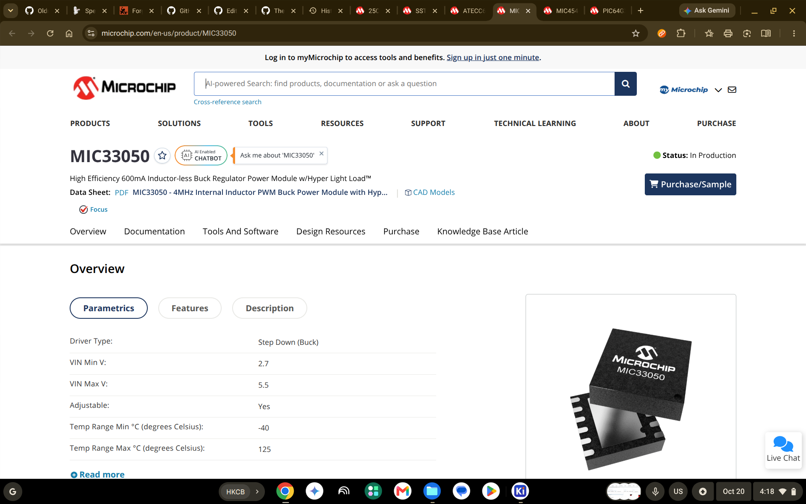
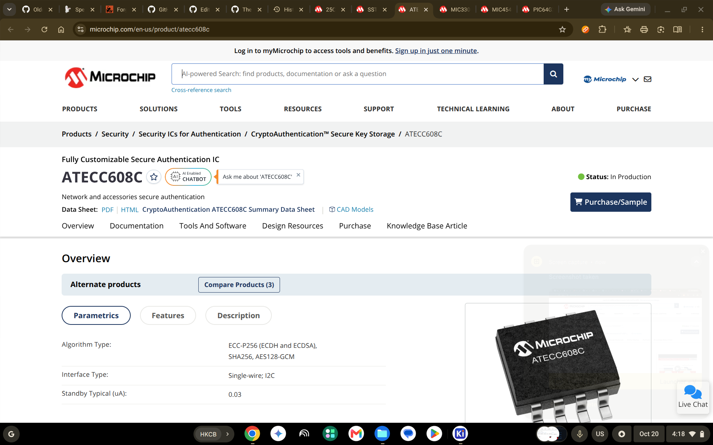

# October 20: Started the part selections.

Just browsed Digikey and other websites for my MCU, Power units, Flash SQI, Boot MEM, and other things. In the end I selected; the PIC64GX1000 for my MCU, for the MCU low power unit I am using the MIC45404; for the peripheral and parts that need higher power I am going to use MIC33050; for the crypto IC unit I am going to use the ATECC608C; for the flash I will be using a SQI based flash MEM, SST26VF064B; for the EEPROM I will use a 25CSM04, and last but not least I will use... A TON...of other parts for this!

**Total time spent: 2.23 hours**
